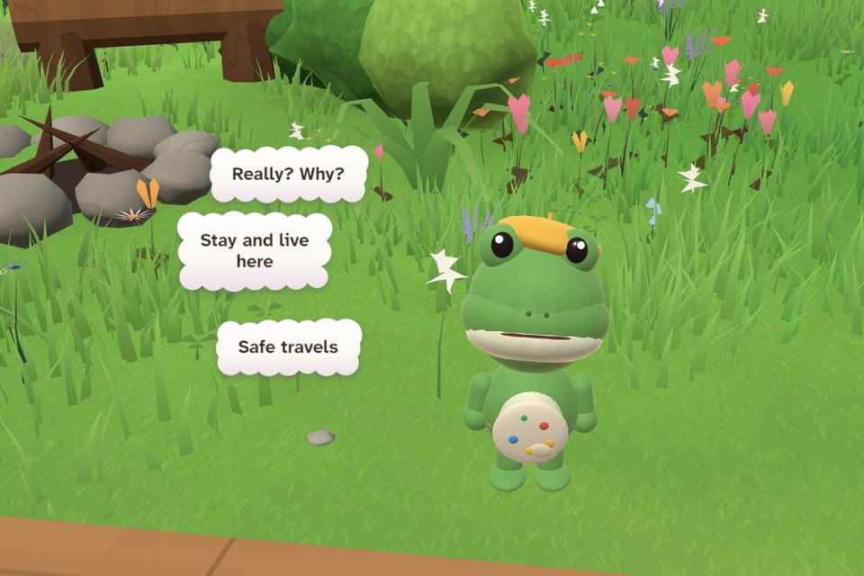
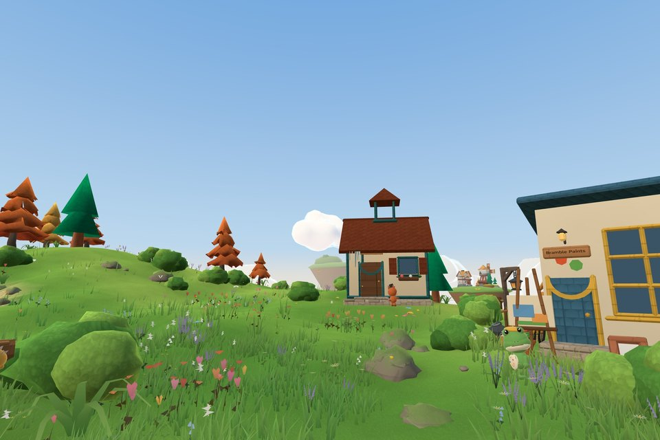
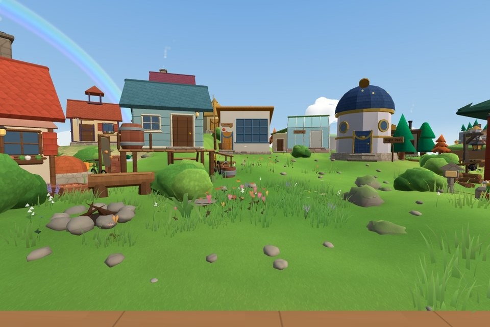
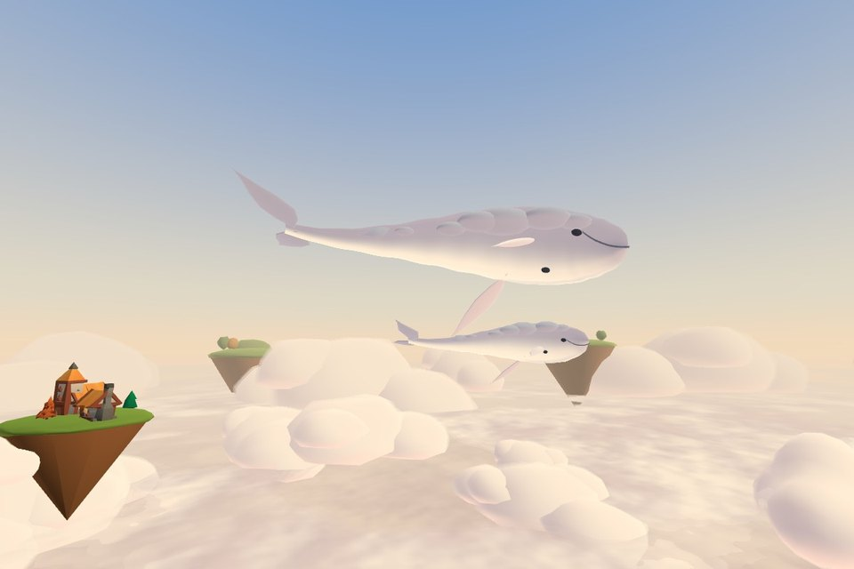
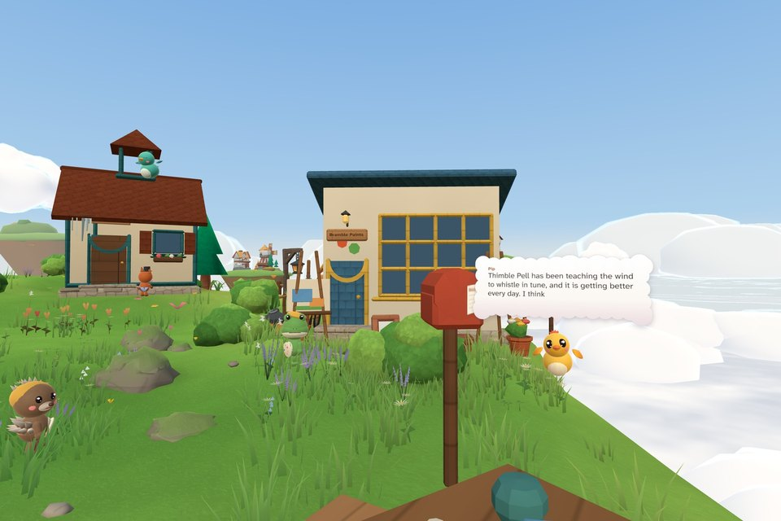
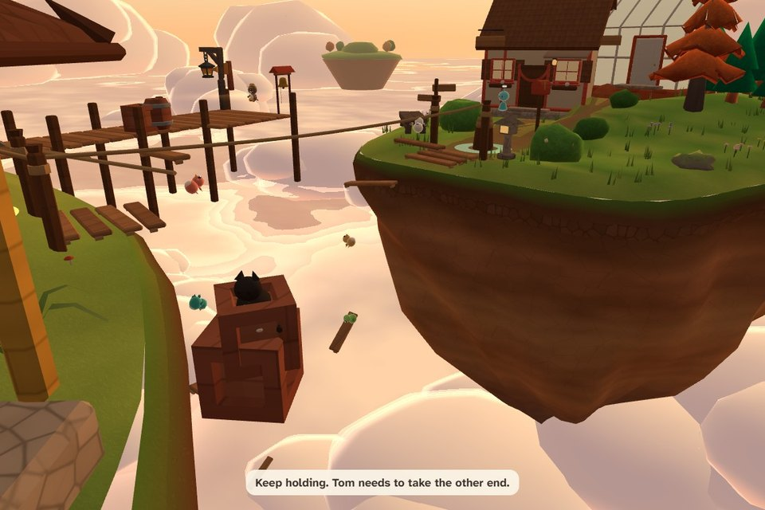
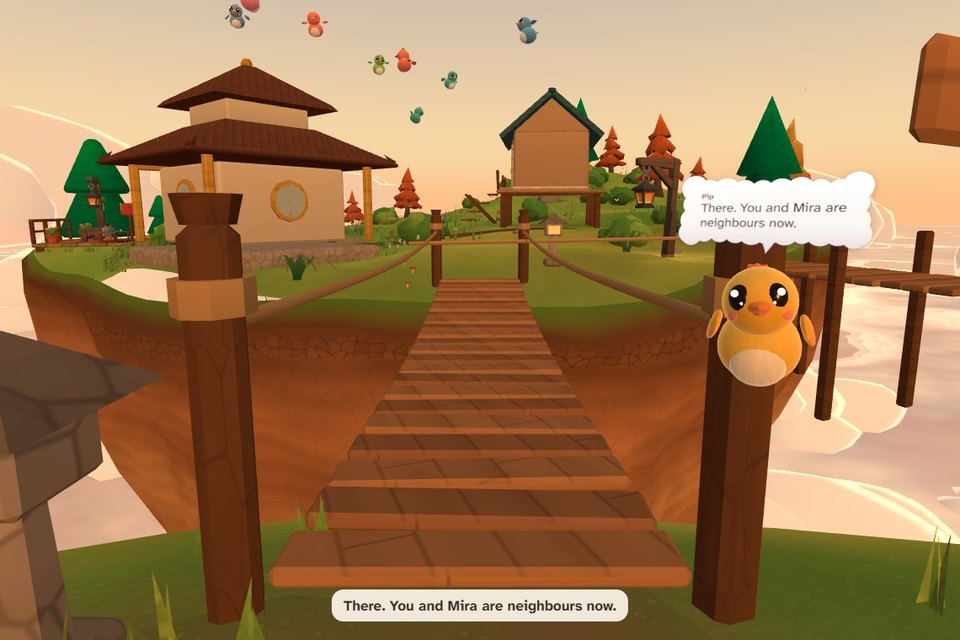
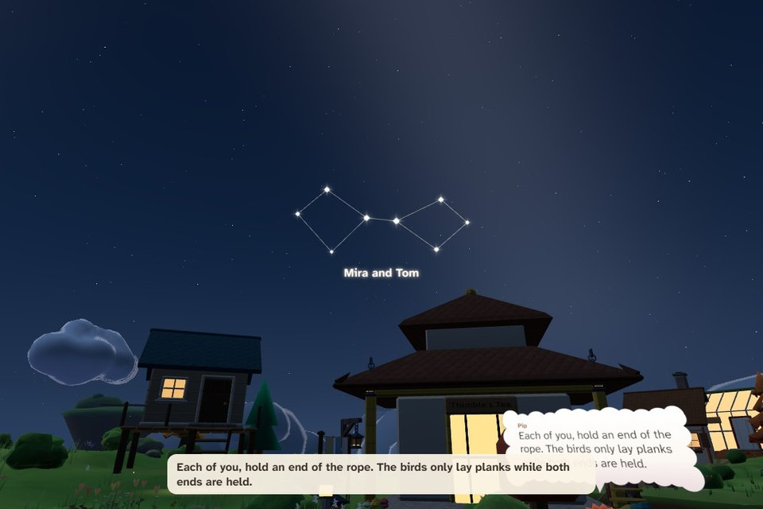
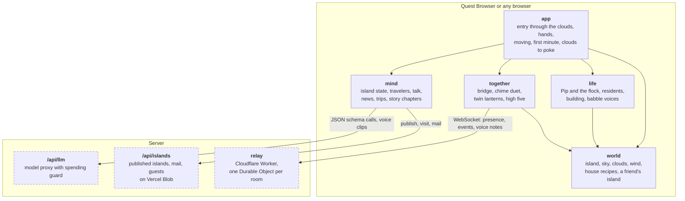

<p align="center">
  
</p>

Wayfolk is a small island of your own, floating in a sea of clouds, that you visit in Meta Quest through Quest Browser. Travelers drift in out of the clouds by balloon, paper boat, kite or umbrella. They are little animal folk, each with a trade, a manner of speaking, a story and a secret, and you talk with them out loud. Ask one to stay, pinch a spot of grass, and a flock of birds builds their house in front of you. Invite a friend, and their island drifts over to dock beside yours. Everything is done with your hands.

<p align="center">
  <a href="https://wayfolk-island.vercel.app"><b>Play Wayfolk at wayfolk-island.vercel.app</b></a>
  <br>
  <sub>Open it in Quest Browser and press <b>Enter the island</b>. On a laptop or a phone, press <b>Look around here</b>.</sub>
</p>

<p align="center">
  
  
  
  
  
</p>

<p align="center">
  
  <br>
  <sub>The flock builds a tea maker's house. Captured from the deployed app in a desktop browser and played at twice the speed.</sub>
</p>

<p align="center">
  <a href="#try-it">Try it</a>&nbsp;&nbsp;&nbsp;
  <a href="#the-first-minute">The first minute</a>&nbsp;&nbsp;&nbsp;
  <a href="#life-on-the-island">Life on the island</a>&nbsp;&nbsp;&nbsp;
  <a href="#together">Together</a>&nbsp;&nbsp;&nbsp;
  <a href="#hands">Hands</a>&nbsp;&nbsp;&nbsp;
  <a href="#how-it-is-built">How it is built</a>&nbsp;&nbsp;&nbsp;
  <a href="#run-it-locally">Run it locally</a>&nbsp;&nbsp;&nbsp;
  <a href="#licenses">Licenses</a>
</p>

## Try it

Wayfolk is a web page, so there is nothing to install. It keeps your island in the browser you play in, and it is made for a few minutes at a time, seated or standing, with your hands.

**In a Quest headset**

1. Put the controllers down so the headset tracks your hands, and open Quest Browser.
2. Go to `wayfolk-island.vercel.app` and press **Enter the island**. If the headset asks to share room data, saying yes lets Wayfolk find a table in your room for the moment you leave. Saying no changes nothing else.
3. Clouds rise from the floor of your room, the walls fade into a sunset, and you are on the edge of your island.
4. Hold out one hand, palm up. Pip, the lead bird, lands on it, and the rest follows from there.

**Without a headset**

The same island runs in any recent desktop or phone browser. The view turns toward whoever is speaking, and a golden arrow hangs in the air over the one next thing to do, so a newcomer always knows where to look. A short hint at the bottom of the page names the key for the moment, and the small **?** in the corner brings the hints back.

| To do this | On a computer | On a phone |
| --- | --- | --- |
| Look around | Drag with the mouse | Drag with a finger |
| Walk | W A S D or the arrow keys, or click the ground where you want to go | The small stick, or tap the ground |
| Talk to Pip or a neighbour | Click them | Tap them |
| Answer | Hold Space or the mic button and speak, or type in **Say something…** | Hold the mic button, or type |
| Pick a quick reply | Click one of the clouds that drift up after a few quiet seconds | Tap a cloud |
| Open Pip's menu | Click Pip, or use the tags at the bottom of the page | Tap Pip |
| Place a house | Click the grass | Tap the grass |
| Hurry a long moment | Click anywhere; Esc stops a story or a song | Tap |

## The first minute

This is what a new island looks like the first time you come, in the headset. The browser version follows the same steps with the mouse and the keyboard.

1. Clouds rise in your room, the walls dissolve into the sunset, and the clouds part around the island.
2. Pip flies up and says, "Oh, you're here. I'm Pip. Hold out your hand, palm up, and I'll come down." When you open your palm, he lands on it and stays there while you move your hand.
3. Pip points out someone drifting in. A traveler arrives at the pier in their own vehicle, walks up the path to stand in front of you, and introduces themselves in a few lines. Their words float above them in a puffy cloud. One of them, Clover Bramble, a frog and a painter, says the wind picked up her lantern and set it down on your pier, so she supposes this is where the paints go now.
4. You answer out loud: raise the hand with Pip to your mouth, say what you like, and lower it. If you stay quiet for a few seconds, three small reply clouds drift up beside your hand, and you can touch one. From the second turn on, one of them always asks the traveler to stay.
5. When they agree, a glowing footprint of their house follows your pointing hand over the island. It is warm where the ground is free and grey where it is not, and turning your wrist turns the house. Pinch to choose.
6. The flock flies out to the edge of the clouds and comes back carrying the pieces, and the house goes up in front of you piece by piece. Its shape comes from the traveler's trade: a baker gets a chimney and an oven, a stargazer gets a dome, a fisher lives on stilts.
7. The windows light up, the new resident walks to their door, and Pip says that someone else will find the island tomorrow.

The first traveler on a new island is always one of four prepared characters, so the opening is the same good scene for everyone and does not wait on a model. Later travelers are written live by the model when it is available.

<table>
  <tr>
    <td width="33%"></td>
    <td width="33%"></td>
    <td width="33%"></td>
  </tr>
</table>
<sub>Talking with a traveler, the flock at work, and a finished home. Captured from the deployed app.</sub>

## Life on the island

**Talking.** Every resident has a name, a species, a trade, a personality, a voice, a story told in beats and a secret. They speak in a babble made from their own voice settings, with their words in a puffy cloud above their head, so there is no wait for speech synthesis and every line is readable. You talk back by voice, or type in a page, and quick reply clouds come only when you have been quiet for a while. Residents remember what you talked about, and their secret comes out slowly over several visits.

**Moving around.** In the headset you can walk for real, point at any patch of grass and pinch to hop there, or pinch the air and draw your hand toward you to pull yourself along as if on a rope, while the edges of the view dim. Glowing rings mark a few good places to stand. In a page you walk with the keys, the stick or a click on the ground, and the island keeps you out of houses, tree trunks and off the cliff edge.

**A living island.** One wind blows over the whole island. Gusts roll across the meadow as visible waves, bend the flowers and trees, and push the scarves, ears and tails of the residents in the same direction at the same moment. Birds flock overhead and perch on roofs, butterflies and bees fly by day and fireflies at night. The sky follows your real clock, from morning through the golden hour and sunset to a night with stars and lit windows. When it rains, every resident opens an umbrella in their own colours and a rainbow follows, and sometimes a whale made of cloud swims past with her calf. The sound is quiet and layered: wind that swells with each gust, birdsong in the trees by day, crickets at night, the pond and the waterfall, chimes on the porch and the crackle of the campfire, each coming from its own place.

**Coming back.** When you return, Pip lands on your hand and tells you what happened while you were away. The island changes to match: a flower patch or a fruit tree has grown, a present waits by your seat, a neighbour has come back from a trip with a story and a souvenir, or a guest from another island has left a note in your mailbox, which a resident reads aloud. Then someone new drifts in out of the clouds, so every visit brings a new traveler to meet.

**Evenings.** By the campfire a resident tells the next chapter of their own story, and it plays in the clouds in front of you as a theatre of paper silhouettes on a small stage with red curtains, with the teller's voice coming from the fire and the line written under the stage. At sunset the musician plays a tune written for that evening, and the island answers it: lanterns, windows, flowers and fireflies pulse with the music, the others dance and the birds circle.

**Small things.** Ring the brass bell by your seat, and the residents come over to wave. Ask Pip to feed the birds, and a few come down to eat crumbs from your palm. Pick a fruit from the branch by your seat, or catch a falling star at night, and hand it to a resident; a gift they love turns up in their house. Stroke Pip with a fingertip and he puffs up and chirps. Light a paper lantern on your palm and let it float to an island on the horizon. Ask Pip for a painting, and the painter sets up an easel, paints your island from a real view of it and hangs the picture by their door.

**Going places.** Send a resident on a trip to another island; they pick up a bag, walk down to the pier and come back hours later with a story and a souvenir. Visit one of the islands on the horizon yourself, meet the folk who live there and leave a note in their mailbox. Taking a postcard publishes your island, and published islands can appear on the horizon of other players.

**A postcard.** Frame the island with the thumbs and index fingers of both hands, or ask Pip with one hand, and a paper card appears with a picture of your view and a QR code. On a phone, the code opens your island in 3D in the browser, to turn and zoom.

**Leaving.** When you say goodbye to Pip, the clouds rise again, your room comes back, and the island waits small and glowing on your real table. Pinch near it to go back in.

<table>
  <tr>
    <td width="33%"></td>
    <td width="33%"></td>
    <td width="33%"></td>
  </tr>
  <tr>
    <td width="33%"></td>
    <td width="33%"></td>
    <td width="33%"></td>
  </tr>
</table>
<sub>Morning, a rainbow after the rain and the whale with her calf; then a story by the fire, a song at sunset and Pip's news on the next visit. Captured from the deployed app.</sub>

## Together

Pip's menu makes an invite link with a QR code. A friend who opens it, in a headset or in a page, sits on your island with you live. You see each other as small felt creatures with floating mitten hands, and the same gesture you use to talk to residents sends your friend a short voice note that plays from where you sit. While a friend is there, Pip's menu offers things to do together that one person cannot do alone.

- **A bridge between islands.** Your friend's own island drifts in from the horizon and docks beside yours. A rope runs across the gap, and each of you holds one end. The birds of both islands lift planks out of the clouds and lay them only while both ends are held; if either of you lets go, the rope sags and the birds wait. When the last plank is down, the rope becomes the rails, the islands stay neighbours on later visits, and residents walk across to visit each other.
- **A chime duet.** Two sets of wind chimes hang by the campfire, one for each of you, tuned so that any two notes agree. One person playing alone makes the island glow a little. When you both play, the lanterns, windows, flowers and fireflies swell far brighter, a low drone rises under the notes, and the residents dance round the fire.
- **Twin lanterns.** If you both let a lantern go within a short while of each other, the two find each other high over the clouds and become a small constellation with both your names under it, which stays in the night sky of both islands.
- **A high five.** When your palm meets your friend's palm, the flock bursts into a spiral round your hands, a warm chord rings, and a postcard of the two of you is taken. In a page, a click on your friend holds up a mitten for them to meet.

<table>
  <tr>
    <td width="33%"></td>
    <td width="33%"></td>
    <td width="33%"></td>
  </tr>
</table>
<sub>Holding the rope while the planks go down, the finished bridge, and the constellation from twin lanterns. Captured from the deployed app, with the friend joining from a second page.</sub>

## Hands

Wayfolk can be played from start to finish with hands alone, within arm's reach, seated or standing.

| Gesture | What happens |
| --- | --- |
| Open a hand, palm up | Pip lands on it; later the same gesture opens Pip's menu |
| Raise the hand with Pip to your mouth, then lower it | Records up to 8 seconds of your voice as an answer |
| Touch a reply cloud with a fingertip, or point at it and pinch | Answers with that cloud |
| Point at the grass and pinch, turning the wrist | Places and turns a new house |
| Point at any grass and pinch briefly | Hops you there |
| Pinch the air and draw the hand toward you | Pulls you along through the air |
| Point at a glowing ring and pinch | Glides you to that spot |
| Touch the bell with a fingertip | Rings it, and the residents come to wave |
| Pinch a fruit or a falling star and let go toward a resident | Gives them a gift |
| Point at a resident and pinch | Opens their clouds: say hello, give a fruit, send on a trip, peek inside |
| Stroke Pip with a fingertip | He puffs up and chirps |
| Frame the view with both hands | Takes a postcard |
| Pinch during a story | Moves on to the next line |
| With a friend: pinch and hold the rope, touch a chime, meet their palm | Builds the bridge, plays the duet, gives a high five |

**Pip on the palm.** Each frame the app reads the hand joints from WebXR and builds a palm point a little off the skin, its normal, and a check that the fingers are spread. A palm counts as open when its normal is within about 57 degrees of straight up and the fingers are spread. Pip lands on an anchor that follows the palm softly, so he rides your hand without jitter.

**Pinch, placement and moving.** A pinch starts when the thumb and index tips come within 22 mm and ends only when they part past 40 mm, so a pinch held loosely does not flicker. The system select event also counts as a pinch, because some runtimes send it before the joints close. When a pinch ends, the aim is taken from the pose a few frames earlier, so the motion of opening the fingers does not throw the house off its spot. A pinch goes first to what it points at (a cloud, a resident, a fruit, a ring, the rope); only a pinch that nothing took becomes a hop or a pull, and only while no scene or conversation is running.

**When tracking drops.** If a hand leaves the cameras, its anchor stays where it was and anything on it waits there, so Pip keeps sitting in the air instead of falling. When the hand comes back, the anchor glides to it over about a third of a second. Every step of the first minute also has a way forward without the hand, so a lost hand never leaves the person stuck.

**One hand is enough.** Every action works with either hand, Pip sits on whichever palm opens first, and the two-handed postcard frame is also in Pip's menu. Reply clouds float beside the hand that is in use, and residents walk up to stand in front of you, so what you act on stays close and in front of you.

## How it is built

Wayfolk is written in TypeScript on IWSDK 1.1, Meta's Immersive Web SDK, which adds an entity component system (ECS) and WebXR session handling on top of Three.js. It is split into five modules with plain factory interfaces, and a server part that runs as Vercel functions and a Cloudflare Worker.



<sub>Solid boxes run in the browser; dashed boxes are server code. The app creates world, then life, then mind, then the live and together parts, and connects them.</sub>

**The world** (`src/world/`). Buildings, fences, lanterns and furniture are pieces from four KayKit packs (CC0), baked once into a single `kit.glb` with vertex colours and converted at load time into the same vertex layout as the island's own procedural geometry, so both merge into a few static batches. Almost everything static is drawn with one Lambert material. The vertex colour's alpha carries a surface id, and the material uses it to add a texture to the palette colour: grass clumps, dirt with pebbles, cobbles, rock, planks, bark, roof tiles, plaster, thatch and brick are painted in code at start-up into one texture array and applied in world space, so there are no texture downloads. The island, rocks, bushes, flowers, clouds, sky, water and the cloud whales are made in code. Twelve house recipes lay out modular pieces in assembly order, each with its own silhouette, and the same order drives the flock's build. Shadows are soft blobs, with no shadow maps. The sound bed is synthesized too, with no audio files.

**Wind** (`src/world/wind.ts`). One function describes the wind for the whole island: a slowly turning direction, a base strength, and gust bands that travel across the island at about 6 m/s. It exists twice with the same formula, once in TypeScript and once in GLSL, so the instanced grass bending on the GPU and a scarf animated on the CPU lean together in the same gust.

**Characters** (`src/life/`). Pip, the flock, the residents and their vehicles are built in code from simple shapes hung on bones and merged into one skinned mesh per character, so a whole resident is one draw call while the head, ears, arms, tail, scarf and eyelids still move on their own. Twelve species share one body plan with different ears, snouts, tails, markings and gaits, and they blink, look around and lean in the wind. The birds are boids with inertia that flock, perch, preen, carry house pieces and circle a finished house. The babble voices are synthesized with Web Audio from each resident's pitch, rate and timbre, and every voice, house and campfire sound is placed in space with an HRTF panner.

**The mind** (`src/mind/`, `api/`). The model writes content inside fixed rules, and code decides what is allowed. A new traveler is generated as JSON against a schema (name, species, trade, personality, voice, colours, story beats, secret, house colours and props), then checked again for lengths, names, colours and words outside the island's style before it can arrive. Talk keeps a short memory per resident and returns a line, three replies and an intent such as stay, leave or gift. The model also writes the news of what happened while you were away and the stories residents bring back from trips. Quest Browser has no speech recognition, so a voice answer is recorded as a short clip, converted to 16 kHz mono WAV in the browser and sent to a model with audio input. The deployed version uses Gemini 3.1 Flash Lite through OpenRouter.

**Story chapters** (`src/mind/chapters.ts`, `src/theatre/`). A chapter is a script: a cast of cut-outs from a fixed vocabulary of 69 silhouettes, and five to thirteen lines, each with up to four stage actions from 16 verbs and 13 stage places. Every chapter, whether prepared, written live or built from the resident's own story beats, passes the same check before the theatre plays it, and the theatre draws the whole stage into one atlas texture.

**Prepared content and the proxy.** If there is no key, the budget is spent, the network is down, or an answer is slow or malformed, the island falls back to a prepared set: 26 travelers recorded once from the model and edited by hand, two story chapters for each, and lines for each trade. The browser page marks a prepared traveler with a small tag. All model calls go through `/api/llm`, which holds the key, checks every answer against its schema, and refuses calls past daily, total, per-session and per-address limits before the provider is called.

**Together** (`src/together/`, `src/live/`, `relay/`). Live visits go through a Cloudflare Worker with one Durable Object per room. The host is authoritative: each guest receives the host's island as a snapshot, presence is sent up to 15 times a second, and only the host can send events that change the island, such as when each bridge plank is lifted and when the bridge is done, so both sides fly the same planks. The friend's island is drawn as a smaller cousin of the main one, merged into a single draw call. Bridges and constellations are kept with the island, so they are still there on the next visit and in the snapshot a later guest receives.

**Islands and visits.** The island lives in IndexedDB on the device. Published islands, mailbox notes and visiting residents are stored by `/api/islands` as JSON records in Vercel Blob, which is how trips and notes reach other islands while their owners are away.

### Performance

Quest Browser runs at 72 Hz, and a standalone headset is comfortable at about 100 to 150 draw calls and 200 to 300 thousand visible triangles, with no real-time shadows and no post-processing. Grass and flowers are instanced with three levels of detail by distance, and grass, flowers and cloud puffs outside the view are packed out of the draw. Static geometry is merged into batches, each character is a single draw call, and the birds that carry bridge planks are hidden when there is no work. A frame counter, `window.__gw.perf.info()`, reports unique draw calls and triangles per eye and is available on any build opened with `?debug=1`.

| Moment | Draw calls per eye | Triangles per eye |
| --- | --- | --- |
| Free play on the island | 63 | about 144,000 |
| A story by the fire | 88 | about 134,000 |
| The sunset concert | 57 | about 153,000 |

<sub>Measured on 17 November 2026 in the Immersive Web Emulator with an emulated Quest 3. The world alone, seen from the seat with twelve houses, is about 139,000 triangles.</sub>

### Limits

- Wayfolk was developed and tested in the Immersive Web Emulator (IWER) with an emulated Quest 3 and emulated hand poses. It has not yet been run on a physical headset, so frame rate on device is still to be measured.
- Your island is stored in the browser where you play. Clearing site data or switching browsers starts a new island.
- Live travelers, talk and voice need the model proxy to be up and within its limits. Otherwise the prepared travelers and lines play, and a voice answer asks you to pick a reply cloud instead.
- Doing things together needs both people on the island at the same time, and only the host can bring a friend's island over for a bridge.

## Run it locally

You need Node.js 20.19 or newer (22.12+ and 24 also work) and npm.

```bash
git clone https://github.com/DarinaX2005X/wayfolk.git
cd wayfolk
npm install
npm run dev
```

`npm run dev` starts the IWSDK dev server at `https://localhost:8081` with a local certificate and opens a managed browser with IWER, IWSDK's browser emulator of a Quest and its hands. The page is ready when the island appears behind the wordmark. To try it on a headset on the same Wi-Fi, open the network address that `npm run dev:status` prints and accept the certificate warning.

Without any settings the app runs fully on prepared content: the model provider is off, published islands live in the dev server's memory until it stops, and live visits use the public relay. To use a model, copy `.env.example` to `.env.local` and set the variables below. Values are never committed.

| Variable | Purpose |
| --- | --- |
| `LLM_PROVIDER` | `openrouter` or `gemini` for a live model; `fixtures` locally and `off` on a deployment by default, which both mean prepared content |
| `OPENROUTER_API_KEY` or `GEMINI_API_KEY` | Key for the chosen provider |
| `LLM_MODEL`, `LLM_AUDIO_MODEL` | Model ids for text and for calls that carry a voice clip; a comma separated list falls back to the next id |
| `LLM_DAILY_USD`, `LLM_TOTAL_USD`, `LLM_RUN_CALLS`, `LLM_DAILY_RUNS_PER_ADDRESS`, `LLM_VOICE_CALLS_PER_ADDRESS` | Spending limits of the proxy |
| `LLM_INSTANCE_COUNTERS` | `1` accepts per-instance spending counters when there is no Redis |
| `BLOB_READ_WRITE_TOKEN` | Vercel Blob store for published islands, mail and guests |
| `STORAGE_DRIVER` | `memory`, `blob-json` or `redis`; `KV_REST_API_URL` and `KV_REST_API_TOKEN` configure Redis |
| `VITE_LIVE_RELAY` | Address of your own relay at build time, for example from `npx wrangler dev` in `relay/` |

These commands check and build the project.

| Command | What it does |
| --- | --- |
| `npm run typecheck` | TypeScript for the app, the API and the tools |
| `npm test` | Unit tests with Vitest, including the mind without a model, the relay logic, the plans behind doing things together and the API routes |
| `npm run build` | Production build into `dist/` |
| `npm run xr -- <scenario>` | Hand scenarios in IWER against the running dev server, with screenshots in `tests/xr/out/` |
| `npm run web -- <scenario>` | Browser and phone scenarios with Playwright |

**Deploying.** The web app and its functions deploy to Vercel with the settings in `vercel.json`. The relay deploys from `relay/` with `npx wrangler deploy`.

## Licenses

- 3D pieces: KayKit Medieval Hexagon Pack, Furniture Bits, Restaurant Bits and Halloween Bits by Kay Lousberg, CC0 1.0. Only the pieces the island uses are baked into `public/assets/world/kit.glb`; the list is in `public/assets/world/LICENSES.md`.
- Font: Atkinson Hyperlegible Next by the Braille Institute of America, SIL Open Font License 1.1.
- The QR encoder follows the reference algorithm of Project Nayuki's QR Code generator library, MIT.
- Everything else you see and hear is made in code in this repository: the island, the characters, the surface textures, the clouds and sky, the wordmark, the voices, the ambient sound and the music.
- Libraries: IWSDK and Three.js (super-three) under their own licenses, listed in `package.json`.
